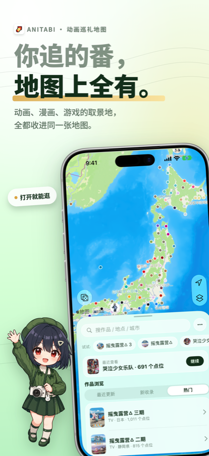
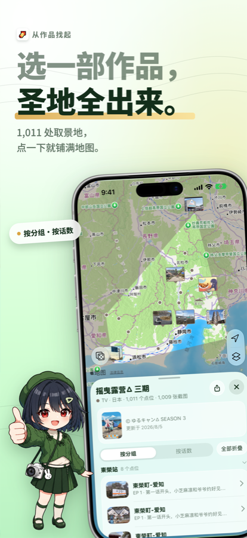
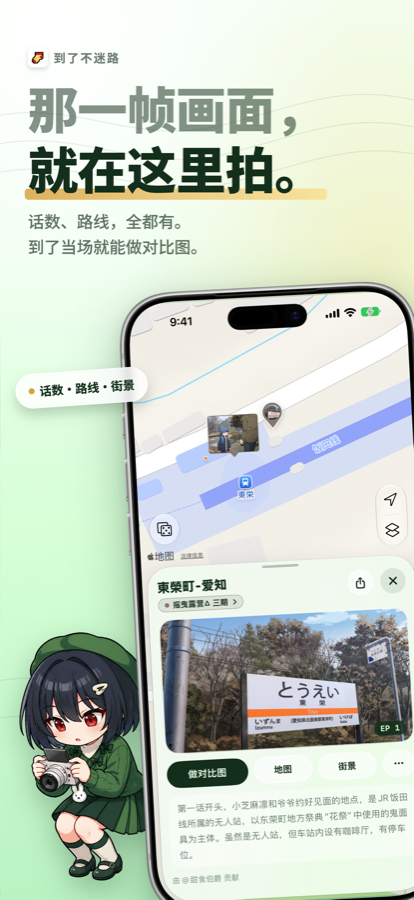
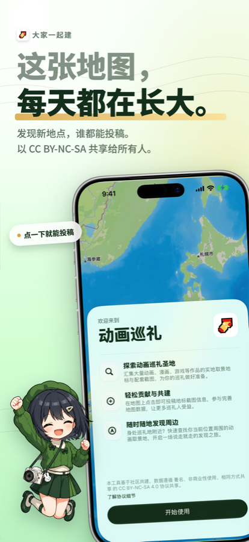
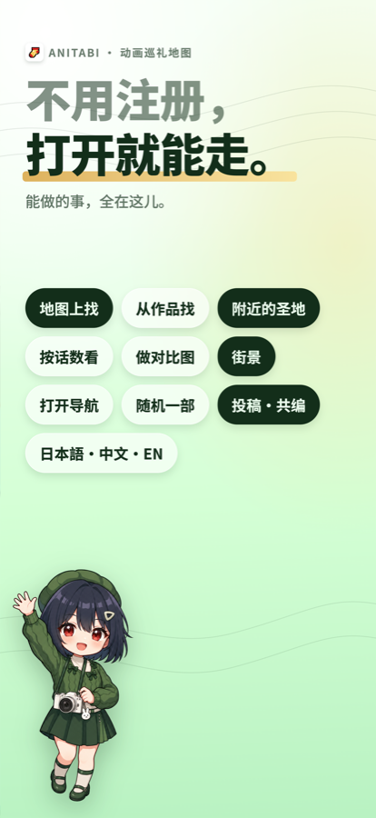

<a href="https://apps.apple.com/us/app/anitabi/id6745898838">
  
</a>

# Anitabi for iOS · 动画巡礼地图

<br clear="both">

<p>
  
  
  
  
  
</p>


告别繁琐的行前准备，轻松开启你的动画圣地巡礼之旅！

**动画巡礼地图（Anitabi Map）** 是一款专为喜爱动画、漫画、游戏、小说等作品的你打造的圣地巡礼辅助工具。我们致力于汇集全球巡礼爱好者的力量，共享作品的取景地标与对应截图，让寻找「次元之壁」在现实世界中的交汇点变得前所未有的简单。

数据来自 [anitabi.cn](https://anitabi.cn/) 社区共建，本仓库是它的 **iOS / iPadOS 原生客户端**。

<br clear="both">

---

## 🆕 2.x：从网页壳到全原生

> [!IMPORTANT]
> 从 **2.0** 起，App 不再是 WebView 网页包转器。地图、卡片、搜索、相机全部用 **SwiftUI + MapKit** 重写，网页只在「投稿 / 修正 / 网页版打开」这类需要登录与后台的入口里出现（以 Safari View Controller 呈现）。

| | |
| --- | --- |
| 🗺️ **原生地图引擎** | `MKMapView` + 自建网格索引，随缩放分级揭示地标。不做数字聚簇泡、不用字母占位，观感对齐 Apple 地图 |
| 🃏 **单卡片模型** | 同一时间只有一张下拉卡片：首页 → 作品 → 地点是内容替换而非层层叠放，返回时各层档位原样弹回 |
| 📷 **原生对比相机** | 系统相机风格取景、焦段切换、剧照叠加与长按 peek、一键合成对比图 |
| ✂️ **角色抠图合影** | Vision 抠出剧照里的角色主体，叠到实景取景框上，可用画笔手动修补边缘 |
| ⚡️ **本地缓存优先** | 全量数据落盘缓存，冷启动直接读本地；服务端 `modified` 没变就跳过详情重下 |
| 🌐 **三语** | 简体中文 / English / 日本語，含 App 名与系统权限文案 |
| 🔗 **深链与接力** | `anitabi://`、`anitabi.cn/map` 与镜像站 `w.junreimap.com` 的分享链接都能直接落到对应点位 |
| 🌓 **深浅色 + 玻璃质感** | iOS 26 Liquid Glass 走兼容层，最低仍支持 iOS 17 |

---

## 📸 界面一览

<table>
  <tr>
    <td width="20%"></td>
    <td width="20%"></td>
    <td width="20%"></td>
    <td width="20%"></td>
    <td width="20%"></td>
  </tr>
  <tr align="center">
    <td>打开就能逛</td>
    <td>选一部作品，圣地全出来</td>
    <td>那一帧画面，就在这里拍</td>
    <td>大家一起建</td>
    <td>不用注册，打开就能走</td>
  </tr>
</table>

---

## 🎯 主要功能

### 🗺️ 地图浏览与查找
- 打开即是一整张世界地图，缩放到城市/街区时逐级显示点位与剧照标注
- 选中作品后，该作品的全部取景地连同区域范围一起铺在地图上
- 搜索框一处搜三种东西：**作品 / 地点 / 城市**；数据在本地，输入即出结果，没有加载等待
- 「附近的圣地」按当前定位排距离；地图左下角的骰子可以**随机跳一部作品**
- 地图设置里可切换**剧照标注**的显示

### 📖 地标与作品详情
- 地点卡片：剧照、话数（EP）、贡献者署名、点位说明
- 作品卡片：按**分组**或按**话数**排列点位，可全部折叠；显示点位数与截图数、更新时间
- 一键跳转 **Google 地图 / 街景 / 导航**，或拷贝坐标
- 长按地图任意位置放下图钉，可直接在该坐标发起添加

### 📷 对比图拍摄（原生相机）
- 系统相机风格取景界面，支持焦段切换与横竖屏
- 剧照半透明叠加、长按 peek 对比，位置/缩放/旋转都能手调
- **角色抠图模式**：抠出剧照中的角色主体单独叠在实景上，边缘可用画笔修补
- 合成后可保存到相册或分享，成品带 App 标识水印

### 📤 便捷投稿贡献
发现新的圣地或想补充已有信息？在地图上对应坐标点击，即可提交地标位置和截图信息，与全球巡礼人共享你的发现。地点卡片里也有「补传截图」「修正坐标」入口。
> 投稿内容需审核后显示

### 📚 海量作品信息
数据库持续建设中，涵盖丰富的动画、漫画、游戏、小说等作品的圣地数据。作品数据主要参考自番组计划（Bangumi）。


### 🙅 巡礼礼仪提示
学校、图书馆一类场所在打开时会给出礼仪提醒 —— 请不要打扰在校师生与馆内秩序，把巡礼留在不打扰任何人的范围里。

<br clear="both">

---

## 🛠️ 开发

| 项 | 值 |
| --- | --- |
| 最低系统 | iOS / iPadOS **17.0** |
| 设备 | iPhone / iPad |
| 语言与框架 | Swift（语言模式 5）、SwiftUI、MapKit、Vision、AVFoundation、Observation |
| 依赖 | 无第三方依赖，不含任何 SPM / CocoaPods 包 |
| 构建 | 用 Xcode 26 或更新版本打开 `anitabi.xcodeproj`，选 `anitabi` scheme 直接跑 |


### 目录结构

```
anitabi/
├── App/            宿主视图、导航状态机、截图水印
├── Map/            MKMapView 封装、标注体系、缩放揭示、镜头规划
├── Sheets/         首页 / 作品 / 地点 / 图钉 / 关于 / 欢迎 等卡片与尺寸真源
├── Controls/       地图右侧玻璃控件列、Toast
├── Home/           数据层：下载、解析、缓存、检索、定位
├── Views/
│   ├── AnimeScene/ 对比相机、角色抠图、合成与结果页
│   └── Image/      图片查看器
├── Support/        深链、外链、相册保存、玻璃兼容层、远端图片
└── Theme/          配色与尺寸标度
```

---

## 🤝 共建与共享


[**Anitabi map**](https://anitabi.cn/) 是一个开放共享的平台，每一位巡礼人的参与都至关重要。你的每一次投稿、每一次反馈，都在帮助更多人实现他们的巡礼梦想。

- **📝 内容贡献**：你的独家发现、详细截图都是宝贵的财富，期待你通过投稿功能加入建设
- **👨‍💼 申请管理员**：如果你热衷于作品圣地信息的整理和维护，欢迎联系我们申请管理员权限，使用后台工具更全面地管理数据 ψ(｀∇´)ψ

<br clear="both">

---

## ⚠️ 重要说明


> [!WARNING]
>
> - 本 App 的巡礼点数据与截图来自 [Anitabi.cn](https://anitabi.cn/) 社区，内容以及最终解释权归 Anitabi.cn 所有
> - 由于 Apple 政策 [App Review Guideline 3.1.1.](https://developer.apple.com/app-store/review/guidelines/#in-app-purchase) 内购政策限制，本 App 屏蔽了所有原本在 Anitabi.cn 上的有关「赞助」相关链接按钮
> - 如您有意赞助此项目，请前往 [Anitabi.cn](https://anitabi.cn/) 点击底部脚页的「赞助」按钮进行赞助

<br clear="both">

### 📜 内容协议
本应用内容遵循 [CC BY-NC-SA 4.0 协议共享](https://creativecommons.org/licenses/by-nc-sa/4.0/deed.zh-hans)。用户投稿内容也将遵循此协议。截图与作品名版权归原权利方所有，仅用于场景对照。

### 🔞 内容限制
请注意：本应用默认屏蔽限制级内容（R限）相关地标信息。

在使用过程中遇到任何问题，或有关于流程、概念上的建议，都欢迎随时与我们联系，帮助我们改进应用体验。

**欢迎下载动画巡礼地图，加入全球巡礼人的大家庭，一起探索和记录那些存在于现实世界的「圣地」吧！**

---

## 🆘 帮助与支持

- **📱 App 相关问题**：[GitHub Issues](https://github.com/anitabi/anitabi-swift-app/issues)
- **🗺️ 地图功能 / 数据问题**：[文档支持](https://github.com/anitabi/anitabi.cn-document/issues)

## 🔒 隐私政策

本 App 不需要注册登录，不会存储以及上传用户信息。定位仅在本机用于「附近的圣地」与地图跟随，相机与相册权限只在制作对比图时使用。

---

<div align="center">
  
  <p><strong>开始你的动画圣地巡礼之旅 🌟</strong></p>
  <p><em>让每一次探索都成为美好的回忆</em></p>
</div>
